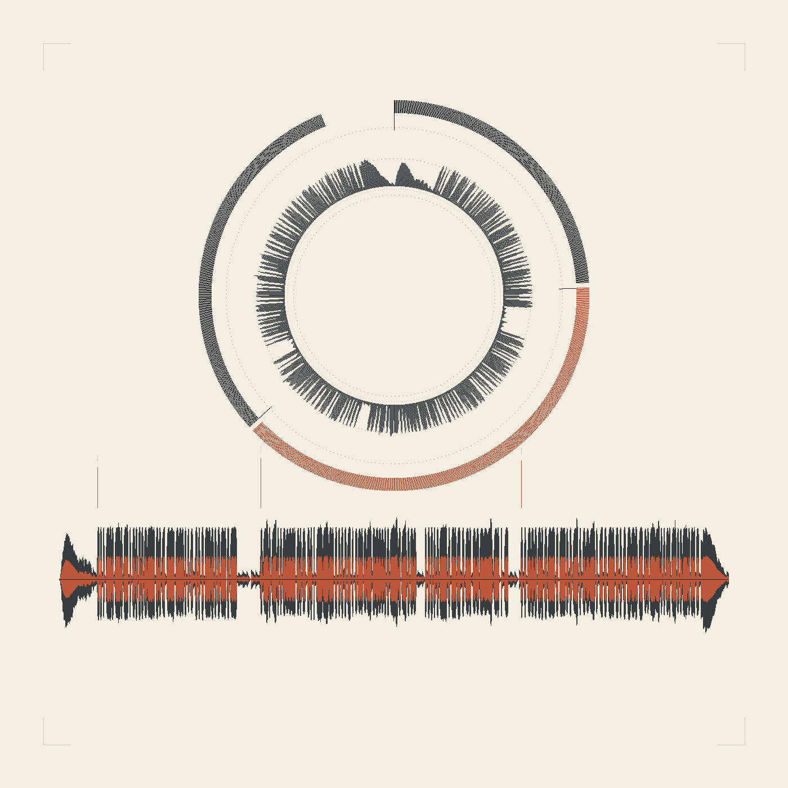

<div align="center">

# opus-video-skills

<a href="README.md"></a>
<a href="README.zh-CN.md"></a>

基于 Claude Opus 5.5 的视频与音频制作技能合集（Claude Code Skills），每种媒介与风格对应一个技能。

</div>

## 概述

本仓库中的每个技能都能让 Claude Opus 5.5 以特定风格独立完成一部完整作品，涵盖分镜、生成、审查、声音与最终编码。所有画面和音乐均由代码程序化生成，不依赖任何图像、视频或音频生成模型。每一帧都由时间唯一确定，在无头 Chrome 中渲染，并由 ffmpeg 编码输出。

## 风格

| 技能 | 媒介 | 典型用途 |
|---|---|---|
| [painted-animation](skills/painted-animation/) | 手绘水彩与墨线卡通，带角色表演 | 动画短片、音乐视频、带卡拉 OK 字幕的歌词 MV |
| [kinetic-reel](skills/kinetic-reel/) | 动态排版：窄体大字、HUD 式小字标注、WebGL 图层 | 作品集短片、Showreel、产品片与片头 |
| [podcast-studio](skills/podcast-studio/) | 脚本化音频：逐句配音、章节间隙、代码生成的开场音与背景乐、成品混音 | 播客、广播剧、旁白解说 |

### painted-animation


使用 p5.js 与水彩笔刷库 p5.brush 绘制每个镜头。角色依托一套表情库与动画原理进行表演，音乐视频按测得的节拍剪辑，歌词 MV 配有逐字卡拉 OK 字幕。示例为陶喆《小镇姑娘》的 31 秒歌词 MV。[说明文档](skills/painted-animation/README.zh-CN.md)。

### kinetic-reel


在二维排版画布之上叠加 three.js 图层（粒子地形、流体大理石纹、铬金属扭结、可聚合成特定形状的粒子云），并经过 WebGL 后期处理。镜头之间采用形状连贯的转场，配乐与画面由同一条时间轴合成。示例为 84 秒的作品集短片《Work Reel ’26》。[说明文档](skills/kinetic-reel/README.zh-CN.md)。

### podcast-studio



把一份 Markdown 脚本做成完整的一集节目：每句台词一行，拥有稳定的内容寻址片段 ID；语音逐句合成；章节间隙与停顿排在同一条时间轴上；开场音与背景乐由代码生成；混音以 −1.5 dBFS 母带输出；导出带章节标记的 MP3；封面由母带波形绘制；并提供带同步文稿的试听页面。示例为一集双主持、三章的演示节目。[说明文档](skills/podcast-studio/README.md)。

## 环境要求

- Claude Code 及 Claude Opus 5.5
- Node.js、Google Chrome、ffmpeg
- Python 3 及 numpy（仅 painted-animation 的节拍检测需要）

podcast-studio 只需要 Node 18+ 即可完成音频母带；ffmpeg 仅在导出 MP3 时需要。

## 安装

**以插件方式安装（推荐）。** 在 Claude Code 中执行：

```
/plugin marketplace add tuzhechen2005/opus-video-skills
/plugin install painted-animation@opus-video-skills
/plugin install kinetic-reel@opus-video-skills
/plugin install podcast-studio@opus-video-skills
```

按需安装。之后用 `/plugin update` 获取新版本。

**以个人技能方式安装。** 克隆仓库一次，再链接所需的技能：

```bash
git clone https://github.com/tuzhechen2005/opus-video-skills ~/opus-video-skills
ln -s ~/opus-video-skills/skills/painted-animation ~/.claude/skills/painted-animation
ln -s ~/opus-video-skills/skills/kinetic-reel ~/.claude/skills/kinetic-reel
ln -s ~/opus-video-skills/skills/podcast-studio ~/.claude/skills/podcast-studio
```

之后在 `~/opus-video-skills` 中执行 `git pull` 即可更新。

> **从 `painted-animation` 升级。** 本仓库原先是单一的 `painted-animation` 技能，安装方式是直接克隆到 `~/.claude/skills/painted-animation`。该技能现已移至 `skills/painted-animation/`，原有安装方式不再有效。请删除旧的克隆，再按上述任一方式重新安装。

## 使用方法

在 Claude Code 中描述所需作品，系统会自动选用匹配的技能，也可以按名称直接调用：

> 制作一段 15 秒的动画：Clawd 试图抓住一只蝴蝶。

> 根据这份简历，把我的三个项目做成一支 60 秒的动态排版短片。

> 做一集 12 分钟的播客，主题是「内部工具为什么会被弃用」，双主持，带章节。

技能会创建项目、提交分镜或脚本、逐个镜头或逐句台词制作并审查，最终将成品输出到项目的 `out/` 目录。

## 目录结构

| 路径 | 说明 |
|---|---|
| `.claude-plugin/marketplace.json` | 插件市场清单（每个技能对应一个插件） |
| `skills/painted-animation/` | 水彩动画技能：引擎、指南与示例 |
| `skills/kinetic-reel/` | 动态排版短片技能：引擎、指南与示例 |
| `skills/podcast-studio/` | 脚本化音频技能：时间轴与混音引擎、脚本格式、混音与配音指南 |

## 新增风格

新增一种风格，即在 `skills/` 下新建一个目录，包含 `SKILL.md`、可直接运行的 `template/` 以及至少一个完整示例，并在 `.claude-plugin/marketplace.json` 中添加对应条目。视频类技能遵循同一套约定：每一帧都是时间的纯函数；`render.mjs` 负责生成关键帧拼图和并行渲染全部帧；最终编码之前，每个镜头都要依据渲染出的画面审查。podcast-studio 与之一脉相承但代码独立：时间轴由脚本与音频片段唯一确定，`build.mjs` 报告仍缺配音的台词，每一句都要依据渲染出的波形审查后才交付母带。

## 致谢

podcast-studio 的流程把 Simone Paiva 的 [Projeto-Dio-Podcast](https://github.com/simonepaiva/Projeto-Dio-Podcast)（用语言模型写脚本、用 ElevenLabs 生成配音）整理为一套可复现、无依赖的构建流程。painted-animation 的动画引擎与指南改编自 John Heibel 的 [ClaudeAnimationBase](https://github.com/JohnHeibel/ClaudeAnimationBase)（MIT 协议），整体方法参照其 [PDoomVideo](https://github.com/JohnHeibel/PDoomVideo)；kinetic-reel 的渲染器同样由该工具包改编而来。本项目使用了 p5.js、p5.brush、three.js、Puppeteer 与 ffmpeg。各技能及示例均由 Claude Opus 5.5 在 Claude Code 中完成。

## 许可协议

MIT，见 [LICENSE](LICENSE)。
