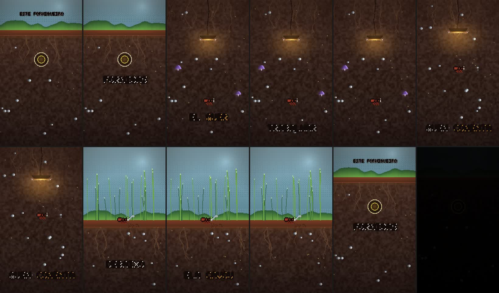

# ant-underground

Vertical pixel-art reels that recruit the viewer, made entirely in code.

A warm underground world — dark brown soil, roots, a hanging lamp, violet mushrooms — with a
dithered sky above it, two-tone pixel captions, and a synthesized score. Every pixel and every
note is generated by the renderer; nothing is imported, sampled, or produced by a model.



## The idea

**In this style the captions carry the whole story, and the story is about the person watching.**

The reference reel is narrated by the ant, in the second person, in the present tense. Its
captions read:

> `ESTE FORMIGUEIRO / FORMIGAS` · `QUER SER / VIRA FORMIGA` · `VIRA FORMIGA / QUEM SEGUE` ·
> `DO GÉU / ELA CAVOU`

The subject of *"vira formiga"* — *becomes an ant* — is dropped on purpose, and it is **the
viewer**, not the speaker. So the reel is not "a video about an ant": it is an ant explaining, in
the viewer's own language, what the viewer just did by following. The ant is the mascot; the
viewer is the protagonist.

That gives the reel its four beats, and its retention mechanism:

| Beat | What it does | The reference |
|---|---|---|
| **The claim** | name the place and what is in it | `ESTE FORMIGUEIRO / FORMIGAS` |
| **The want** | the speaker's ambition, first person | `QUER SER / VIRA FORMIGA` |
| **The invitation** | the viewer is pulled in — follow, comment, save | `QUEM SEGUE` |
| **The cliffhanger** | something concrete and unfinished | `DO GÉU / ELA CAVOU` |

And it hides the call to action inside the fiction: the reel never writes the word "follow", it
just makes following the premise. **[references/storytelling.md](references/storytelling.md) has
the full method** — the caption grammar, the engagement mechanics and the failure modes.

## What makes it different from flat pixel art

The artwork is authored on a **180×320 buffer** and blown up ×6 with nearest-neighbour at the end,
so the pixel grid survives. But the pixels are not flat squares:

- the sky is **dithered** with a 4×4 Bayer matrix, so it reads as woven texture;
- the soil is a **noise lattice** with two octaves, so it never bands;
- the lamp throws a **soft elliptical pool** that falls downward and fades to exactly zero;
- the type is a **chunky bitmap font** with a dark outline and a two-tone cream/amber palette.

The result sits between flat pixel art (a spreadsheet) and a smooth illustration (a photograph).

## The reel

A 23 s short in five shots. The soundtrack is a low drone that rises with the ant, a heartbeat
pulse, and mallets on the shot changes — all synthesized in Node from the same timeline the
picture uses.

| | |
|---|---|
| Format | 1080×1920 (9:16), 30 fps, ~1.27 Mbps, AAC 192 kbps at −15 LUFS |
| Working buffer | 180×320, upscaled ×6, nearest-neighbour |
| Render | ~40–60 ms/frame in headless Chrome, 4 workers in parallel |

## Files

| Path | What it is |
|---|---|
| [SKILL.md](SKILL.md) | the method: scaffold, storyboard, build, review, encode |
| [references/storytelling.md](references/storytelling.md) | the story method: the four beats, the caption grammar, the engagement mechanics |
| [references/style-guide.md](references/style-guide.md) | the look — palette, composition, light, motion, type |
| [references/technique.md](references/technique.md) | the machinery — the buffer, the dither, the noise, the font |
| [docs/reference-measurements.md](docs/reference-measurements.md) | the palette and layout measured from the reference frames |
| [template/](template/) | a runnable 23 s reel that uses every technique |
| [examples/formigueiro/](examples/formigueiro/) | a worked example: a different story and a cooler palette |

## Use it

```bash
bash scripts/new_project.sh my-reel
cd my-reel
# write the captions first — see references/storytelling.md
node render.mjs --sheet=1,5,9 --cols=3 --w=360 --out=out/check/sheet.jpg   # look at it
node music/score.mjs
node render.mjs --frames --workers=4
node render.mjs --encode --audio=assets/score.m4a --out=out/reel.mp4
```

Needs Node.js, Google Chrome (or Chromium) and ffmpeg.

## Licence

MIT, like the rest of this repository.
