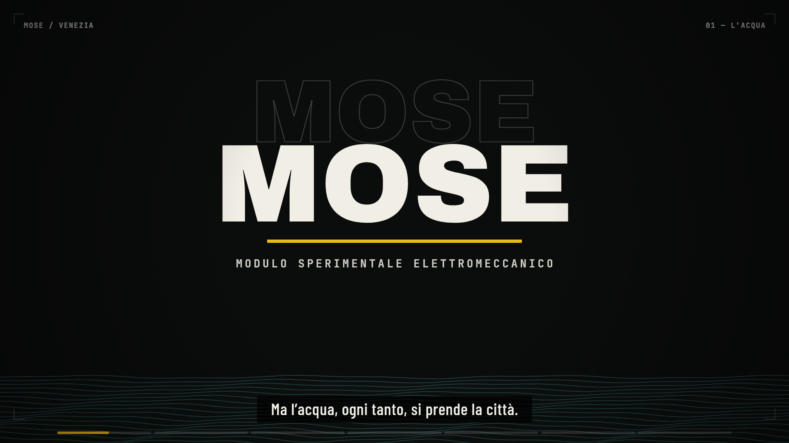

# Worked example: MOSE — Venezia (62 s, Italian, with voice-over)

A one-minute explainer reel about the MOSE flood barrier, made end to end in this idiom: 1920×1080 at 24 fps,
condensed Italian type, a gold "gate" ground, procedural section drawings, a synthesized score, and a narration
synthesised line by line.



## Files

| Path | What it is |
|---|---|
| `src/cues.js` | the 62 s timeline: scene spans `S`, voice cues `VO` (with their measured durations), the fact sheet `FACTS` |
| `src/scene.js` | all seven scenes, the shared primitives (drop-in letters, HUD, callouts, skyline, gates), the transition map, `draw(t)` |
| `music/score.mjs` | the score, written against the same cues: felt piano, low pizzicato, air, soft kick, a rising sub under the gates |
| `scripts/mix.mjs` | voice + score → `out/mix.wav`, with ducking; measures the clips and writes their durations back into `cues.js` |
| `assets/voice/vo-0*.wav` | the narration clips (5 used of 8 recorded) |
| `render.mjs` | contact sheets, stills, frame render and MP4 encode |

## How it was made

```bash
# 1. facts first, on screen, with their scope (see FACTS in src/cues.js)
# 2. voice, line by line, then measure it — the picture is timed to the clips, not to a guess
node scripts/mix.mjs                     # writes out/mix.wav and the durations into src/cues.js
node music/score.mjs                     # writes music/score.wav against those cues
node scripts/mix.mjs                     # re-mix with the real score

# 3. look at every shot, several times
node render.mjs --sheet=2,9,12,17,24,28,30.4,34,44,53,58,61 --cols=4 --w=480 --out=out/check/sheet.png
node render.mjs --still=20 --out=out/check/f20.png
node render.mjs --sheet=15.3,15.5,15.65,15.8 --cols=4 --w=480 --out=out/check/tr.png   # a seam

# 4. render and encode
node render.mjs --clip --audio=out/mix.wav --out=out/mose.mp4
```

Rendering this example needs `@napi-rs/canvas` and a fontsource checkout (Barlow Condensed, Archivo Black,
JetBrains Mono, Instrument Serif), plus ffmpeg on `PATH` (or `FFMPEG=/path/to/ffmpeg`):

```bash
npm i @napi-rs/canvas
npm i @fontsource/barlow-condensed @fontsource/archivo-black @fontsource/jetbrains-mono @fontsource/instrument-serif
FONT_DIR=node_modules/@fontsource node render.mjs --clip --audio=out/mix.wav --out=out/mose.mp4
```

## The structure (62 s, 120 BPM, cuts on the bar)

| t | shot | mechanism | transition in |
|---|---|---|---|
| 0.0 | cold open | the mark → the word MOSE → 187 cm counting up over rising water | — |
| 8.2 | the threshold | section drawing: a gate resting on the seabed, a ruler to 300 cm, the 110 cm line, air bubbles | hard cut |
| 15.6 | the gates | 18 gates in section, each rotating up on its own beat; a marea gauge crossing 110; a 30′ counter | gold bar grows across the frame |
| 31.0 | the city kept dry | split screen: laguna +70 inside (gold, city) / sea +130 outside (ink, rain) | the wall opens outward |
| 37.6 | the numbers | 110 cm · 78 gates · 30 min, then 78 bars (one per gate, brick at each inlet) | cream wipe |
| 47.2 | the questions | 150 ticks (one per raising), cost, still water | ink slats |
| 55.8 | close | "Il MOSE non ferma l'acqua. Compra tempo." + the mark | hard cut |

## Notes worth keeping

- **Italian sets type differently.** Condensed Barlow at 90–130 px fits one clause per line; anything longer needs
  two lines, and the drop-in stagger has to be tighter (0.014–0.018 s) or the line arrives late against the voice.
- **Subtitles are timed from the clips.** `mix.mjs` writes each clip's measured duration into `cues.js`, and the
  subtitle track splits the line across words by character count. Nothing is hand-timed.
- **The two halves of the fact are separate.** "Regge maree fino a 3 metri" (built limit) and "non è progettato per
  chiudere oltre" (the consequence) are stated, not implied. Anything illustrative — the section, the gate count
  drawn — carries `SCHEMA, NON IN SCALA`.
- **The gate is drawn, not projected.** A rectangle rotated about a hinge, with a gold gradient and ribs. At this
  scale it reads correctly and costs nothing; three.js would add a dependency for no gain.
- **Transitions follow the picture**: a bar grows out of the seabed line, the wall opens outward, a page wipe, slats.
  Never three of one kind in a row; each is 0.5–0.55 s.
