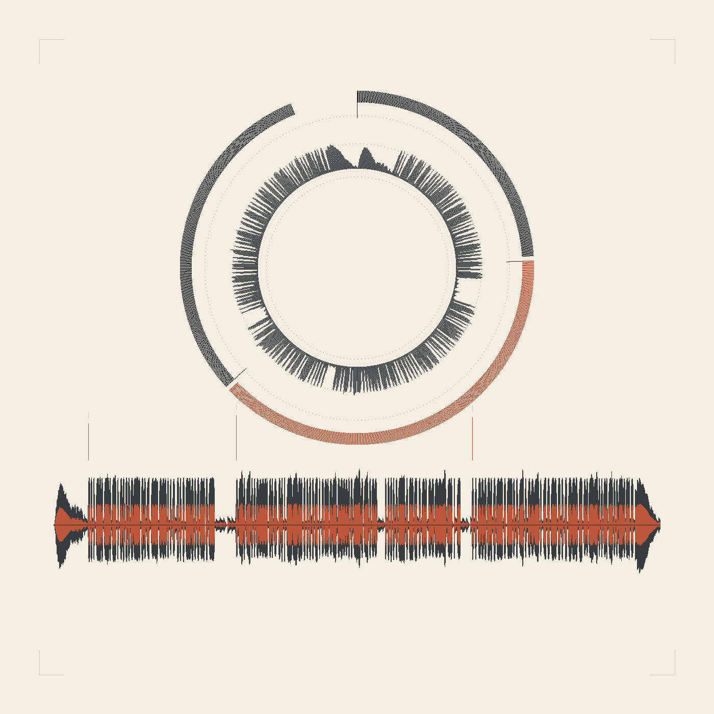
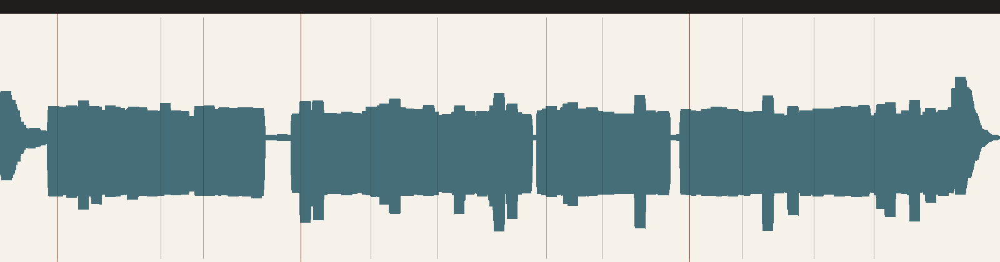

<div align="center">

# podcast-studio

A Claude Code skill for producing complete podcast episodes with Claude Opus 5.5.
Part of [opus-video-skills](../../README.md).

</div>



## Overview

The skill takes an episode from a Markdown script to a mastered, chapter-marked audio file, plus cover art and a review
player. The speech is the only thing a model produces; the sting, the chapter breaks, the music bed, the mix, the
master, the MP3 chapters and the cover art are all generated in code.

The workflow comes from podcast projects assembled by hand — a script written with a language model, a voice rendered
per paragraph in ElevenLabs, then cut together — and turns that into a pipeline where the script is the edit and every
other artefact is derived from it.

## How It Works

1. **Script.** `script.md` holds one line per speaker turn, `##` chapters and `[beat]` pauses. Lines are the unit of
   revision: each gets a stable content-addressed id, so editing one line invalidates exactly one clip.
2. **Voice.** `node lib/lines.mjs` reports every line that has no clip yet, with its voice, text and target file. The
   agent synthesises those lines and drops them in `assets/voice/`.
3. **Build.** `lib/build.mjs` lays out the timeline (turn gaps, paragraph pauses, chapter beats), adds sting, bed and
   tag, masters to −1.5 dBFS through a soft-knee limiter, and writes `out/master.wav`, `out/timeline.json`,
   `out/cues.csv` and a waveform review image.
4. **Review.** `out/check/waveform.png` shows one mark per line and the chapter breaks; `out/player.html` plays the
   episode with a synced, scrolling transcript.
5. **Publish.** `lib/export.mjs` writes an MP3 with chapter markers (if ffmpeg is installed) and `lib/poster.mjs`
   draws a 3000×3000 cover from the master waveform and the chapter map.



## Characteristics

- **No dependencies.** Node 18+ builds the episode; ffmpeg is only needed for MP3 export.
- **Deterministic.** The sting, tag, bed and cover are pure functions of the config and the audio — rebuilding an
  unchanged episode gives the same files.
- **Idempotent revisions.** Re-record one line without re-timing the rest; the timeline recomputes itself from what
  exists.
- **Honest about pacing.** The build prints duration, speech share, words per minute, chapter count, lines far off the
  episode's usual pace, and every line that still has no clip.
- **Series-ready.** One `voices.json`, one palette, one sting: episodes stay coherent while the script changes.

## Requirements

- Claude Code with Claude Opus 5.5 (or any agent that can run Node and call a speech tool)
- Node.js 18+
- ffmpeg — optional, for MP3/AAC export with chapter markers

## Installation

Install the whole collection as plugins (see the [repository README](../../README.md)), or link this skill directly:

```bash
git clone https://github.com/tuzhechen2005/opus-video-skills ~/opus-video-skills
ln -s ~/opus-video-skills/skills/podcast-studio ~/.claude/skills/podcast-studio
```

## Usage

Describe the episode in Claude Code. The skill is selected automatically, or invoke it by name:

> Make a 12-minute podcast episode about why internal tools get abandoned, two hosts, with chapters.

> Here is my script and an ElevenLabs recording — assemble the episode, add music and cover art.

## Getting started in a project

```bash
bash scripts/new_project.sh my-episode --keep-demo
cd my-episode
node lib/lines.mjs          # what needs a voice
node lib/build.mjs          # timeline, mix, master
node lib/player.mjs         # out/player.html — listen
node lib/poster.mjs         # out/cover.png
node lib/export.mjs         # out/episode.mp3
node lib/import-audio.mjs --plan   # audio you already have: ElevenLabs takes, a human recording
```

The full method, the rules that matter and the engine's gotchas are in [SKILL.md](SKILL.md); the script format is in
[references/script-format.md](references/script-format.md), mixing and mastering in
[references/sound.md](references/sound.md), and casting and clips in [references/voice.md](references/voice.md).

## License

MIT. See [LICENSE](../../LICENSE).
